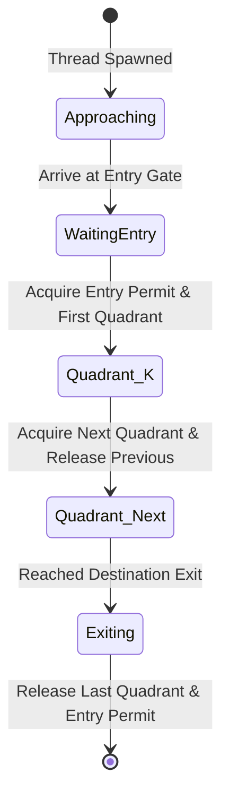

# Roundabout Traffic Simulation & Deadlock Avoidance

## 1. Overview
The Roundabout Simulator models real-world circular junction dynamics where multiple concurrent vehicles (threads) request access to sequential quadrants (critical shared resources). Without synchronization or priority arbitration, circular wait conditions inevitably lead to system-wide gridlock (deadlock).

```
                 North Entry / Exit
                       [ N ]
                         |
                 +---------------+
                 |  Quadrant 0   |
          [ W ]--| (North-West)  |--[ E ]
                 |               |
                 |  Quadrant 1   |
          West   | (South-West)  |   East
          Entry/ |               |   Entry/
          Exit   |  Quadrant 2   |   Exit
                 | (South-East)  |
                 |               |
                 |  Quadrant 3   |
                 | (North-East)  |
                 +---------------+
                         |
                       [ S ]
                 South Entry / Exit
```

---

## 2. Theoretical Concurrency Model

### 2.1 Coffman Conditions Analysis
A deadlock in resource allocation requires four simultaneous conditions:
1. **Mutual Exclusion:** Each quadrant within the roundabout has a strictly finite vehicle capacity ($K \ge 1$). A vehicle holds exclusive occupancy of a slot within a quadrant.
2. **Hold and Wait:** A vehicle occupying quadrant $Q_i$ requests admission to quadrant $Q_{(i+1) \pmod 4}$ before relinquishing $Q_i$.
3. **No Preemption:** Vehicles cannot be forcefully ejected or teleported out of a quadrant while transitioning.
4. **Circular Wait:** A closed cycle exists such that:
   $$V_0 \to Q_1 \land V_1 \to Q_2 \land V_2 \to Q_3 \land V_3 \to Q_0$$
   where $V_k$ holds $Q_k$ and waits for $Q_{(k+1) \pmod 4}$.

### 2.2 Prevention and Avoidance Strategies

#### A. Semaphore Capacity Regulation
Each quadrant is guarded by a POSIX counting semaphore:
```c
sem_t quadrant_sem[4];
sem_init(&quadrant_sem[i], 0, QUADRANT_CAPACITY);
```

#### B. Global Roundabout Invariant (Breaking Circular Wait)
To mathematically prevent a cyclic dependency among full quadrants, the total number of vehicles concurrently traversing the roundabout is bounded by:
$$N_{\text{max\_total}} = \sum_{i=0}^3 C_i - 1$$
By guaranteeing at least one vacant slot across the ring topology at all times via a master entry semaphore (`sem_t entry_permit`), the cycle cannot close, guaranteeing liveness (progress).

#### C. Asymmetric Resource Acquisition (Dijkstra Hierarchy)
For single-slot junctions, quadrant acquisition order is strictly ordered or uses two-phase reservation (`sem_trywait` with randomized exponential backoff), precluding indefinite hold-and-wait.

---

## 3. Architecture & Implementation

### 3.1 Data Structures
```c
typedef struct {
    uint32_t id;
    entry_point_t entry;
    exit_point_t exit;
    uint32_t delay_ms;
    vehicle_state_t state;
} vehicle_t;

typedef struct {
    sem_t quadrants[4];
    sem_t capacity_guard;
    pthread_mutex_t stats_lock;
    uint64_t total_vehicles_passed;
    uint64_t total_wait_time_us;
} roundabout_t;
```

### 3.2 Vehicle Transit State Machine


---

## 4. Verification & Testing

The suite includes deterministic stress tests verifying:
- **No Deadlocks:** Under saturated loads (e.g., 200+ concurrent threads).
- **FIFO Fairness:** Entry queues prevent starvation of vehicles originating from minor approaches.
- **Resource Cleanup:** All semaphores, mutexes, and allocated memory structures are cleanly deallocated on shutdown.
